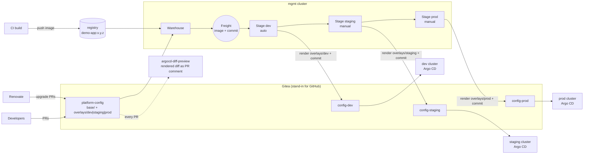

# Kargo + argocd-diff-preview + Renovate — promotion demo

A fully local demo (kind + Gitea + a local registry) that mirrors an account like
**dev5**: three environments (**dev → staging → prod**), each on **its own cluster
with its own Argo CD**, fed by a main config repo with per-env overlays.

It shows three tools that each fix one part of the problem:

| Problem today | Tool | What changes |
|---|---|---|
| A bespoke pipeline works out *which overlay folder* changed and pushes to `config-<env>`. Nobody can easily answer "what version is in prod, and how did it get there?" | **Kargo** | One declarative pipeline. Every new image + config commit becomes a versioned **Freight**. Kargo renders the overlay and commits to the env repo. Promotions are ordered (dev → staging → prod), auditable, and one click (or rollback). |
| A YAML diff on `base/` looks harmless, but you can't see what it does to *rendered* manifests in each env | **argocd-diff-preview** | Every PR gets a comment with the real rendered diff for dev, staging, and prod before merge. |
| Third-party images and charts drift and get bumped by hand | **Renovate** | Opens upgrade PRs automatically. These PRs get the diff preview, and once merged, Kargo promotes them like any other change. |

## Architecture



Each env's Argo CD **knows nothing about Kargo**: it still just watches its own
`config-<env>` repo, exactly as today. Kargo only replaces the promotion pipeline in
front of it, so it can be adopted without touching the clusters.

## Prerequisites

- podman (or Docker), `kind`, `kubectl`, `helm`, `git`, `jq`, `openssl`, `curl`
- About 8 GB of RAM for the container VM (12 GB is more comfortable:
  `podman machine stop && podman machine set --memory 12288 && podman machine start`)
- `make up` downloads the `kargo` and `argocd-diff-preview` CLIs into `./bin`.

## Quick start

```bash
make up        # ~10 min the first time
make status    # what runs where + every URL
```

| What | URL | Login |
|---|---|---|
| Kargo UI | https://localhost:8443 (self-signed cert) | `admin` / `admin1234` |
| Gitea | http://localhost:3000 | `platform-admin` / `Demo-Passw0rd!` |
| Argo CD dev / staging / prod | http://localhost:8081 / 8082 / 8083 | `admin` / `admin1234` |
| The app in dev / staging / prod | http://localhost:9081 / 9082 / 9083 | – |

Open the Kargo UI, the three app URLs, and Gitea in browser tabs before you start.

## Demo script (~20 min)

> Before the talk: run `make reset` (clean day 0) and `make warm`, which
> pre-creates the diff-preview cluster so each diff takes seconds instead of
> about 2 minutes.

### Act 1: Kargo replaces the overlay-folder pipeline

1. **Show the starting state.** In the Kargo UI, `demo-app 1.0.0` is already in dev
   (green page on :9081), and staging/prod are empty. Open `kargo/` and point out
   that this is the entire pipeline: about 170 lines of YAML, with **one**
   `PromotionTask` reused by all three environments.
2. **CI ships a new build:** `make release V=1.1.0`
   - A new Freight appears in Kargo (image `1.1.0` plus the current config commit).
   - dev auto-promotes. Show the commit by `kargo-bot` in Gitea → `config-dev`. It
     contains plain rendered YAML, so you can see exactly what Argo CD will apply.
   - dev's Argo CD syncs, and :9081 shows `1.1.0`.
3. **Promote to staging:** click *Promote* on the staging stage (or `make promote TO=staging`).
   Staging turns orange on :9082. Prod is still empty.
4. **Show the guardrail:** try to promote a Freight that never went through staging
   straight to prod. Kargo answers *"Freight … is not available to Stage prod"*.
   The ordering is enforced, not just a convention.
5. **Roll back:** after another `make release V=1.2.0` → staging, pick the older
   Freight for **staging** and promote it. That's the whole rollback; there's no
   hunting for the right commit to revert. (Do it on staging: dev auto-promotes,
   so it would move forward to the newest Freight again.)

### Act 2: catch problems before merge with argocd-diff-preview

1. `make scenario NAME=dev-only-flag`: a PR titled *"Enable new checkout flow in dev"*.
   In the Gitea diff it's three innocent lines in `base/`.
2. `make diff B=feature/dev-only-flag`: the comment on the PR shows
   **demo-app-dev, demo-app-staging, and demo-app-prod** all changing. It isn't
   dev-only.
3. `make scenario NAME=selector-rename` → `make diff B=feature/selector-rename`:
   a "label cleanup" changes the **immutable Deployment selector** in every
   env, which would break the sync in all three clusters after merge.
4. Compare with `make scenario NAME=good-change` → `make diff B=feature/good-change`:
   only `demo-app-dev` changes. That's what a dev-only change looks like.
5. `make scenario NAME=prod-replicas`: replicas `3 → 30`, and the diff shows it only
   in prod, so it's easy to catch in review.

### Act 3: Renovate, diff preview, and Kargo together

1. `make renovate`: renovate-bot opens PRs to bump `redis` (a minor bump and a
   separate major bump with a `major-upgrade` label).
2. `make diff B=renovate/redis-7.x`: the rendered diff shows the image bump in all three envs.
3. Merge the PR in Gitea. Within about 15 s Kargo creates a new Freight (*same app
   image, new config commit*). It auto-lands in dev only, and staging/prod stay on
   the old redis until someone promotes it. `make status` shows this:

   ```
   ENV       APP     REDIS    KARGO FREIGHT
   dev       1.1.0   7.4.12   <new freight>
   staging   1.1.0   7.2.4    <old freight>
   ```
4. Promote it through staging → prod. The dependency upgrade gets exactly the same
   gated path as an app release.

### Key messages

- **One pipeline definition** instead of logic that maps folders to repos.
  Adding an env is about 15 lines (a Stage), not pipeline surgery.
- **Freight = image + config commit.** It's always clear which *combination* is in
  each env, and the same combination moves forward, so you never get "latest main".
- **Argo CD stays as it is.** Each cluster's Argo CD keeps watching its own repo, and
  Kargo only writes to git.
- **Shift left.** argocd-diff-preview shows the rendered blast radius on the PR,
  for humans and for Renovate.

## How it maps to the real setup

| Demo | Real world |
|---|---|
| Gitea `platform/*` | GitHub `platform-config`, `config-dev`, `config-staging`, `config-prod` |
| `kind-registry:5000` | ECR. Use `kargo.akuity.io/cred-type: image` creds or IRSA |
| `scripts/diff-preview.sh` | `ci-examples/github/workflows/argocd-diff-preview.yaml` (GitHub Action) |
| `scripts/renovate.sh` | Hosted Renovate app; config in `ci-examples/github/renovate.json` |
| prod pushes directly | `ci-examples/kargo/prod-stage-with-pr.yaml`: Kargo opens a PR on `config-prod` and waits for approval, and that PR also gets a diff-preview comment |
| Kargo health = "promotion succeeded" | Next step: **Kargo sharding**. Run a Kargo controller per cluster (`controller.shardName` plus `kubeconfigSecrets.argocd`) so `argocd-update`/verification steps read each env's own Argo CD health. |

## Layout

```
kargo/                  the whole promotion pipeline (Project, Warehouse, PromotionTask, Stages)
repos/platform-config/  seed for the main config repo (base, overlays, argocd-preview apps, renovate.json)
argocd/                 per-cluster Argo CD values + the single Application each cluster watches
app/                    demo-app image (nginx printing version + env)
scripts/                00-06 setup, plus build-image, scenario, diff-preview, renovate, status, reset, down
ci-examples/            GitHub Action for diff-preview, production Renovate config, PR-based prod stage
```

## Troubleshooting

| Symptom | Cause / fix |
|---|---|
| `unable to create session key: disk quota exceeded` | Rootless podman VM keyring limit. `00-prereqs.sh` raises `kernel.keys.maxkeys`; rerun it. |
| diff-preview `TLS handshake timeout` | The VM is CPU-starved. Wait a minute and rerun, give podman more CPU/RAM, or use `make warm`. |
| `kind get clusters` errors on podman 6 | Known kind/podman label-format incompatibility. The scripts avoid this command. |
| Kargo `refused to get credentials for insecure HTTP endpoint` | Kargo blocks credentials over HTTP by default. The demo sets `controller.allowCredentialsOverHTTP=true` because Gitea is plain HTTP. Never do this in production. |
| A stage looks stuck | `kubectl --context kind-mgmt -n dev5 get promotions`, or open the promotion in the Kargo UI to see step-by-step logs. |
