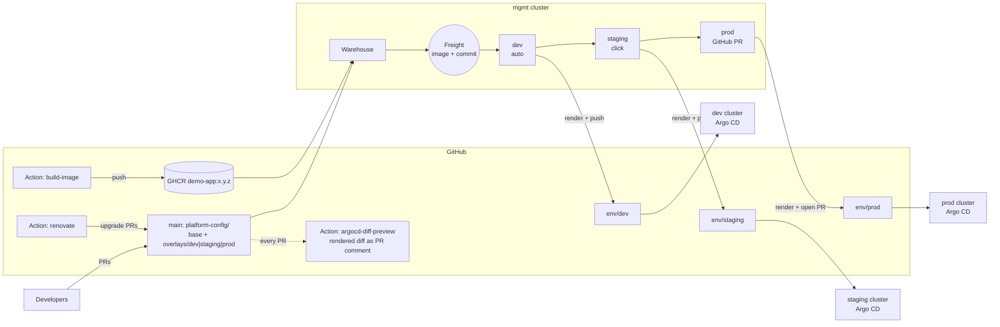

# Kargo + argocd-diff-preview + Renovate: promotion demo

A demo of an account like **dev5**: three environments (**dev → staging → prod**),
each on **its own cluster with its own Argo CD**, fed by one config repo with
per-env overlays.

It shows three tools that each fix one part of the problem:

| Problem today | Tool | What changes |
|---|---|---|
| A bespoke pipeline works out *which overlay folder* changed and pushes to that env's config repo. Nobody can easily answer "what version is in prod, and how did it get there?" | **Kargo** | One declarative pipeline. Every new image + config commit becomes a versioned **Freight**. Kargo renders the overlay and commits to the env branch. Promotions are ordered (dev → staging → prod), auditable, and one click (or rollback). prod goes through a **GitHub PR**. |
| A YAML diff on `base/` looks harmless, but you can't see what it does to the *rendered* manifests in each env | **argocd-diff-preview** (GitHub Action) | Every PR gets a comment with the real rendered diff for dev, staging, and prod before merge. |
| Third-party images drift and get bumped by hand | **Renovate** (GitHub Action) | Opens upgrade PRs on a schedule. They get the diff preview, and once merged Kargo promotes them like any other change. |

## What runs where

| Where | What |
|---|---|
| **GitHub** | `main`: `platform-config/` (base + overlays), plus the demo tooling |
| | `env/dev`, `env/staging`, `env/prod`: rendered manifests, **written only by Kargo**. These stand in for the separate per-env config repos. |
| | Actions: `build-image` (→ GHCR), `argocd-diff-preview` (PR comments), `renovate` (scheduled) |
| | GHCR: `ghcr.io/david-wagih/demo-app` |
| **Your laptop (kind)** | `mgmt` cluster: Kargo |
| | `dev`, `staging`, `prod` clusters: one Argo CD each, watching *only* its own `env/<env>` branch |



Each env's Argo CD **knows nothing about Kargo**: it just watches its own branch,
as it does today. Kargo replaces only the promotion pipeline in front of it.

## Setup

**Prerequisites:** podman (or Docker), `kind`, `kubectl`, `helm`, `git`, `gh` (logged in), `jq`, `curl`, `openssl`.
Give the container VM ~8 GB of RAM (12 GB is more comfortable).

```bash
make up        # ~10 min the first time: 4 kind clusters, 3x Argo CD, Kargo, env branches
make status    # what runs where + every URL
```

On a fresh fork:

```bash
./scripts/use-fork.sh <you>/<repo> && git commit -am "use my fork" && git push
git tag -f -a demo-baseline -m "demo day 0" && git push -f origin demo-baseline   # what `make reset` restores
make release                    # first image, 1.0.0 (GHCR inherits the public repo's visibility)
make up
```

Kargo pushes with your `gh` token by default. To scope it down, export `GITHUB_TOKEN`
before `make up`, set to a fine-grained PAT with *Contents* + *Pull requests* write on
this one repo.

| What | Where | Login |
|---|---|---|
| Kargo UI | https://localhost:8443 (self-signed) | `admin` / `admin1234` |
| Argo CD dev / staging / prod | http://localhost:8081 / 8082 / 8083 | `admin` / `admin1234` |
| The app dev / staging / prod | http://localhost:9081 / 9082 / 9083 | – |
| PRs, Actions, env branches | https://github.com/david-wagih/kargo-promotion-demo | – |

## Demo script (~25 min)

The whole demo is scripted and reproducible:

```bash
make reset      # day 0: closes demo PRs, resets env branches, restores platform-config/ + app/
                # from the `demo-baseline` tag, recreates the Kargo project (~2 min)
make demo       # guided run: pauses before every step and waits for the real outcome
                # (Freight created, Argo CD synced, diff comment posted, PR merged...)
make demo ACT=2 # jump to an act
make rehearse   # unattended dress rehearsal (merges PRs itself), then resets
```

During `make demo`, the merges are yours: when a step needs one, it prints the PR
link and waits until you merge it in GitHub. Keep Kargo, the three app URLs, and
the repo's *Pull requests* and *Actions* tabs open in your browser.

`make release` always builds the **next free version** (1.1.0, 1.2.0, ...), so it
never collides with images from earlier runs.

The acts below describe what `make demo` does and what to say at each step.

### Act 1: Kargo replaces the overlay-folder pipeline

1. **Show the starting state:** the newest image is in dev (green page on :9081), and
   staging/prod are empty. Show `kargo/`: that's the entire pipeline, with **one**
   `PromotionTask` reused by all three envs.
2. **CI ships a new build:** `make release`. This runs the `build-image` Action
   and pushes to GHCR. A new Freight appears in Kargo, and dev auto-promotes. Show the
   `kargo-bot` commit on `env/dev`. It's plain rendered YAML, and the commit message
   names the Freight.
3. **Promote to staging:** click *Promote* in Kargo (or `make promote TO=staging`).
   Staging turns orange on :9082.
4. **Promote to prod: change management for free.** Click *Promote* on prod.
   Kargo **opens a GitHub PR against `env/prod`** whose *Files changed* tab is the
   exact rendered YAML prod will get. The promotion waits while someone reviews and
   merges. Merge it, and prod turns blue on :9083.
5. **Show the guardrail:** promoting dev-only Freight straight to prod fails with
   *"Freight … is not available to Stage prod"*.
6. **Roll back:** after a second release reaches staging, promote the older Freight
   to staging again. That's the whole rollback. (Use staging: dev auto-promotes, so
   it would move forward again.)

### Act 2: catch problems before merge with argocd-diff-preview

| `make scenario NAME=…` | The PR says… | The diff-preview comment shows… |
|---|---|---|
| `dev-only-flag` | "Enable new checkout flow in **dev**" | dev, staging, **and prod** all change, because it was edited in `base/` |
| `selector-rename` | "Small label cleanup" | the **immutable Deployment selector** changes in every env, so Argo CD sync would fail after merge |
| `prod-replicas` | "Scale prod" | prod replicas `3 → 30` (a typo caught in review) |
| `good-change` | "Dev-only cosmetic change" | only `demo-app-dev` changes. This is what a safe change looks like. |

Each PR gets its comment from the **Argo CD Diff Preview** Action about 2 minutes
after it opens. The Action spins up an ephemeral Argo CD, renders both branches, and
diffs them.

### Act 3: Renovate, diff preview, and Kargo together

1. `make renovate` (or wait for the weekday schedule). Renovate opens PRs:
   redis minor, redis **major** (labelled `major-upgrade`), and the app's nginx base image.
2. The workflow then dispatches a diff preview for each Renovate PR. Open the redis
   7.4 PR: the comment shows the image bump in all three envs.
3. Merge it. Within about 15 s Kargo creates a new Freight (*same app image, new
   config commit*). It lands in dev only, and staging/prod stay on the old redis until
   promoted (`make status`).
4. Promote it to staging, then prod via the PR. The dependency upgrade gets exactly
   the same gated path as an app release.

### Key messages

- **One pipeline definition** instead of logic that maps folders to repos.
  Adding an env is about 15 lines (a Stage).
- **Freight = image + config commit.** It's always clear which *combination* runs
  where, and the same combination moves forward.
- **Argo CD stays as it is.** Kargo only writes git, so it can be adopted without
  touching the clusters.
- **Shift left.** Rendered diffs on every PR (humans *and* Renovate), and a reviewed
  rendered diff for every prod promotion.

## How it maps to the real setup

| Demo | Real world |
|---|---|
| `env/*` branches in one repo | Separate `config-<env>` repos. Only `repo` in the PromotionTask/Stage vars changes. |
| GHCR | ECR, with `kargo.akuity.io/cred-type: image` creds or IRSA |
| Renovate with `GITHUB_TOKEN` | Mend Renovate GitHub App (its PRs trigger workflows directly) |
| Kargo polls every 15 s | Kargo GitHub webhook receiver for instant Freight |
| Kargo health = "promotion succeeded" | **Kargo sharding**: a controller per cluster (`controller.shardName` + `kubeconfigSecrets.argocd`) so `argocd-update`/verification read each env's Argo CD health |

## Layout

```
.github/workflows/      build-image, argocd-diff-preview, renovate
kargo/                  the whole promotion pipeline (Project, Warehouse, PromotionTask, Stages)
platform-config/        base + overlays + argocd-preview Applications (what diff-preview renders)
argocd/                 per-cluster Argo CD values + the single Application each cluster watches
app/                    demo-app image (nginx printing version + env)
scripts/                00-05 setup, release, scenario, status, reset, down, use-fork
renovate.json           Renovate config (kustomize + Dockerfile managers; our own image excluded)
```

## Troubleshooting

| Symptom | Cause / fix |
|---|---|
| `unable to create session key: disk quota exceeded` | Rootless podman VM keyring limit. `00-prereqs.sh` raises `kernel.keys.maxkeys`. |
| `kind get clusters` errors on podman 6 | Known kind/podman label-format incompatibility. The scripts avoid this command. |
| Renovate PRs show an extra "action_required" diff-preview run | Expected. GitHub doesn't run `pull_request` workflows for bot-token PRs, so the Renovate workflow dispatches the diff preview instead, and that run is the one that comments. |
| Renovate opens no redis PR after a reset | `renovate.json` needs `"recreateWhen": "always"`. Without it, Renovate won't reopen a PR it has seen closed. |
| prod promotion stays *Running* | It's waiting for its GitHub PR to be merged; that's the gate. |
| A stage looks stuck | `kubectl --context kind-mgmt -n dev5 get promotions`, or open the promotion in the Kargo UI for step-by-step logs. |
